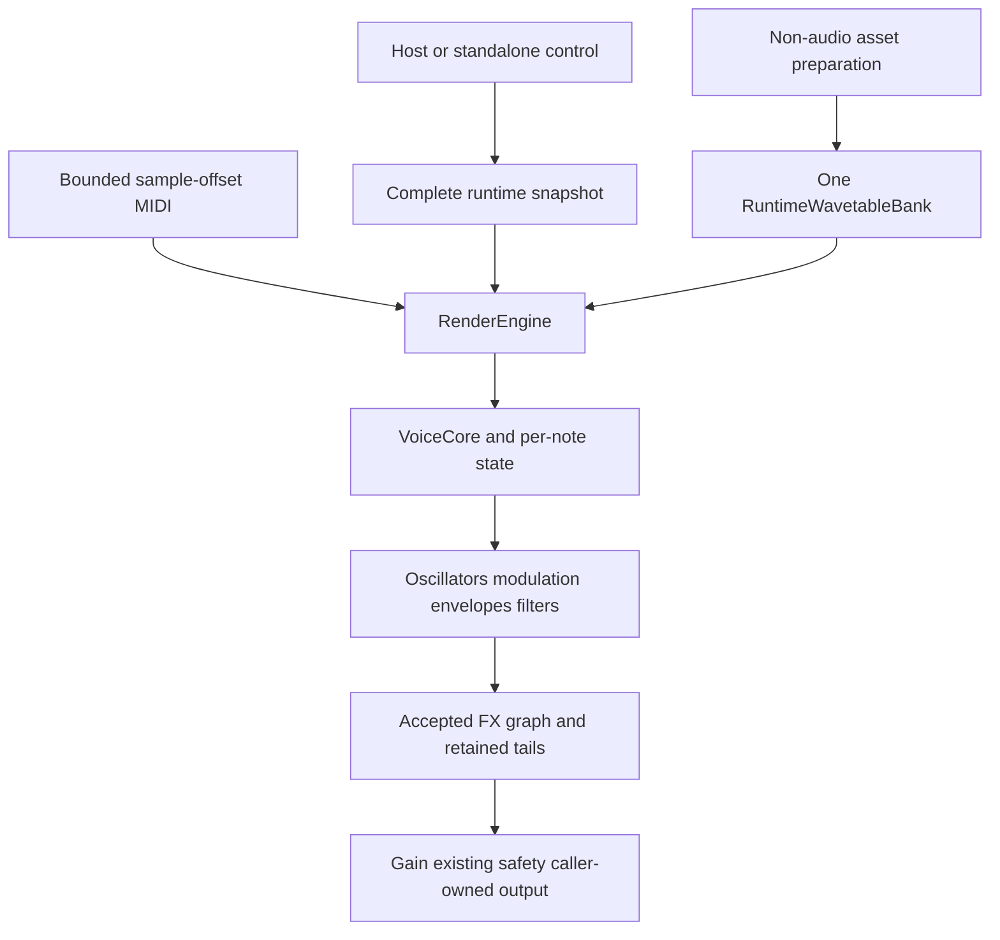

# Architecture and ownership

This diagram shows responsibilities, not every direct-out/bypass/routing branch.
Exact execution is in `VoiceCore::renderNextBlockWithContext` and
`RenderEngine::renderInternal/renderChunk/processFx`.

| Area | Source entry |
| --- | --- |
| Lifecycle, MIDI dispatch, snapshot/asset acceptance | `include/fad/engine/synth/RenderEngine.h`, `src/RenderEngine.cpp` |
| Active note/key/pedal/channel owner and voice execution | `synth/VoiceCore.h`, `src/VoiceCore.cpp` |
| Oscillator/FM/Noise/sub behavior | `oscillators/`, `src/OscillatorBlock.cpp` |
| Snapshot/enums/ranges/curve data | `parameters/`, `src/ParameterSnapshot.cpp` |
| Resource layout and publication | `assets/`, `src/WavetableData.cpp`, `src/WavetableBank.cpp` |
| LFO/envelopes/modulation | `modulation/`, `src/Lfo.cpp`, `src/ModMatrix.cpp` |
| FX processors/catalog/factory/graph/tails | `fx/`, `src/fx/` |
| Non-owning sample views and RT primitives | `AudioView.h`, `AudioBlock.h`, `rt/`, `math/` |
| Real integration examples | `examples/minimal/`, `examples/headless/`, `examples/vst3/` |

Header subdirectories in this table are relative to `include/fad/engine/`.

## Lifecycle

Create bank and graph before the engine that borrows them. Prepare at a stopped,
exclusive lifecycle boundary; allocate scratch and design data there. Render with
caller-owned sample planes and bounded event arrays. Stop callbacks before
teardown, destroy the engine and finish its retirement work before bank/graph.

`AudioView` borrows both the pointer table and channel storage. A view does not
copy samples, retain storage or make an asynchronous borrow safe.

## Complete state and resource handoff

A snapshot is runtime input, not a preset schema. An adapter owns user state,
normalization, persistence and restore/preview authority. It publishes coherent
candidates; audio makes bounded reads/acceptance attempts and keeps the previous
complete state when new resources or graph are not ready.

Resources are immutable after publication. Prepare a new cohort, associate its
generation with the corresponding snapshot, resolve and pin it for audio, then
retire old owners only after all possible readers leave. Shared-owner queries,
FFT preparation, commits and complex destruction belong to safe threads.

FX construction does not immediately make a graph audible. It must match the
accepted snapshot. A real host callback has one structural acceptance boundary,
even if automation divides it into render chunks. Graph transitions retain the
necessary old tails and effective old/new latency bound.

## Downstream responsibilities

The host adapter supplies audio layout, events, transport, normalized-parameter
mapping and persistent state. A product may add authorization outside the Core.
It must not put file parsing, network/Keychain access, UI work or blocking waits
in the audio callback. There is no account or commercial-product bypass in the
independent examples.

---

VST is a registered trademark of Steinberg Media Technologies GmbH.
