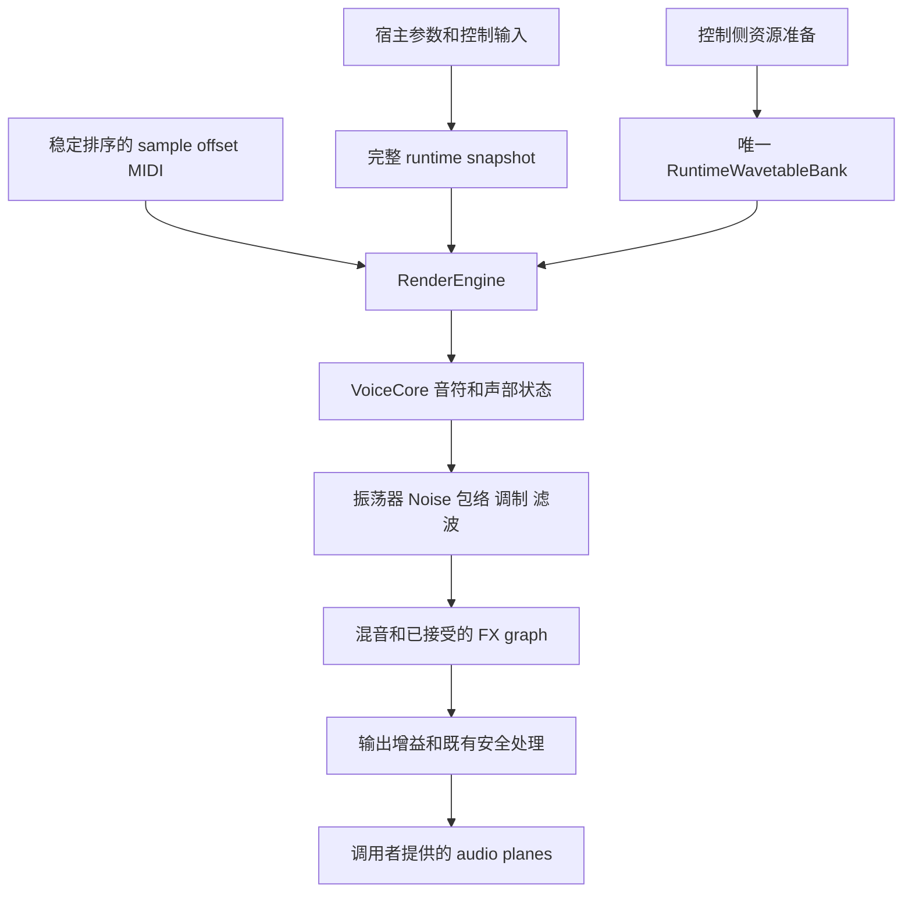
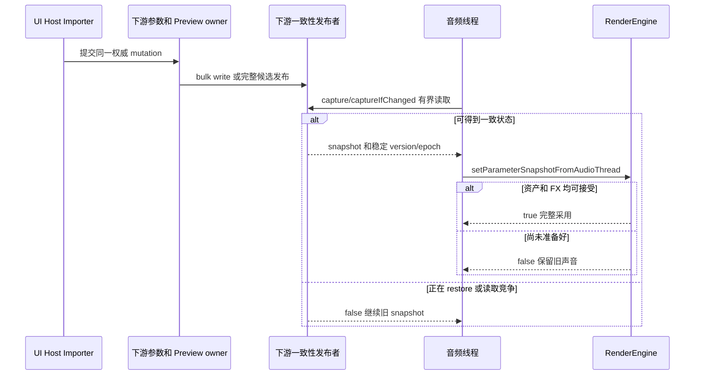

# FAD Engine 详细开发指南

面向会使用 C++/CMake、准备开发合成器或接入新宿主的开发者。先构建独立 Core 和最小声音，再按任务进入参数、MIDI、资源和 FX。

本仓库不包含私有 FAD 产品。下面所有源码路径都以当前仓库根为准；产品持久化、UI、设备和账户系统由下游负责。接口为 C++20 源码接口，许可见根 LICENSE。

## 1 先确定自己在开发哪一层

Core包含runtime snapshot、voice/MIDI、振荡器、波表/Noise、包络/LFO/调制、滤波、FX graph、latency/tail、资源发布/退役及既有安全处理。文件解析、音频设备、UI和产品授权留给下游adapter。

CMake target为 `FadEngineCore`，下游链接 `FAD::EngineCore`。基础类型主要位于 `fad::engine`，已有参数/DSP模块保留 `fadmodel1::parameters` 和 `fadmodel1::dsp`。`<fad/engine/Engine.h>`只提供部分别名，不是包含全部模块的umbrella header。

首版没有稳定C++二进制ABI承诺；换源码/headers/compiler配置后重建受影响消费者。Core内部也有控制侧mutex、准备和退役worker，不能把“没有JUCE依赖”解释成“所有方法都可实时调用”。

| 术语 | 含义 |
| --- | --- |
| sample/frame | 一个声道的数值是sample，同一时刻所有声道合为frame。 |
| block/callback | 宿主交给处理器的一段frames；一次callback可以拆成多个render chunk。 |
| voice/unison | voice拥有音符执行状态，unison是振荡器内的相位/失谐叠加。 |
| normalized | 通常为0–1控制空间，映射到Hz/秒/dB由参数定义负责。 |
| snapshot | 可完整读取的声音投影，不是磁盘preset格式。 |
| generation/cohort | 资源发布版本与共同固定寿命的一组owner。 |
| epoch | 权威状态换代，用于拒绝旧事件或迟到结果。 |
| latency/tail | 处理时间偏移与输入停止后的继续发声。 |


## 2 第一次构建和发声

先按 [快速开始](QUICK_START.md) 配置自己的本地build。默认顶层构建包含六项Core检查、最小消费者及WAV renderer；可选VST3默认关闭。多配置generator显式指定Release；Debug用于诊断，不拿来宣称正常性能。

```sh
cmake -S . -B build -DCMAKE_BUILD_TYPE=Release
cmake --build build --parallel 4
ctest --test-dir build --output-on-failure --no-tests=error
./build/FadEngineMinimal
./build/FadEngineRender --output first-sound.wav --sample-rate 48000 \
  --block-size 512 --seconds 3 --seed 1178682369
```

renderer输出双声道IEEE float32 WAV，已有文件拒绝覆盖；编码/I/O在render调用之外，不添加归一化或额外裁剪。note-on在帧0，note-off在总时长三分之二。Gain/Tone/Attack/Release是demo的normalized controls，具体范围读当前 `--help`。

最小消费者使用真实bank、graph和RenderEngine，演示一秒声音、跨block的note-off及finite/non-silent检查，不创建音频设备或写WAV。源码见 [minimal_render.cpp](../examples/minimal/minimal_render.cpp)。

| 开关 | 顶层默认 | 用途 |
| --- | --- | --- |
| FAD_ENGINE_BUILD_TESTS | ON | 六项独立Core检查。 |
| FAD_ENGINE_BUILD_RENDERER | ON | WAV renderer。 |
| FAD_ENGINE_BUILD_MINIMAL_EXAMPLE | ON | 最小C++消费者，tests开启时再注册一项检查。 |
| FAD_ENGINE_BUILD_VST3_DEMO | OFF | 独立固定官方SDK示例。 |
| FAD_ENGINE_BUILD_TEST_VARIANT | OFF | 同源码instrumented变体，不安装导出。 |

这些默认值在作为子项目时可不同，以当前CMake和 `ctest -N` 为准。source观察不是binary构建来源证明，旧可执行文件不自动代表新修改。


## 3 把 Engine 接入自己的工程

```cmake
cmake_minimum_required(VERSION 3.24)
project(MyInstrument LANGUAGES CXX)
set(FAD_ENGINE_BUILD_TESTS OFF CACHE BOOL "No embedded tests")
set(FAD_ENGINE_BUILD_RENDERER OFF CACHE BOOL "No embedded renderer")
set(FAD_ENGINE_BUILD_MINIMAL_EXAMPLE OFF CACHE BOOL "No embedded example")
set(FAD_ENGINE_BUILD_VST3_DEMO OFF CACHE BOOL "No SDK requirement")
add_subdirectory(path/to/FAD_Engine fad-engine)
add_executable(MyInstrument main.cpp)
target_link_libraries(MyInstrument PRIVATE FAD::EngineCore)
```

公共include和C++20要求通过target传递，不需要下游产品源码。也可 `cmake --install build --prefix "$PWD/stage"`，在下游使用 `find_package(FadEngine 0.1.0 EXACT CONFIG REQUIRED)` 并设置 `CMAKE_PREFIX_PATH`。当前config的版本兼容策略是ExactVersion，安装包含许可证和通知。

生命周期顺序：

1. 创建bank、graph，再创建借用它们的RenderEngine。
2. 新独占离线实例可在prepare前stage初始snapshot；运行中走正常发布/接受。
3. 在停止callback的生命周期边界prepare，准备voices/scratch/FX。
4. render只借用有效planes和有界event数组，失败采用保留旧完整状态的策略。
5. 先停止所有callback和借用者，再在安全线程销毁Engine及其退役worker，最后销毁graph/bank。

`prepare`、生命周期reset和析构不能从运行中的callback任意调用。成员声明顺序也要保证逆序析构正确。


## 4 源码阅读地图

| 问题 | 入口 |
| --- | --- |
| 最小集成和声音 | [minimal](../examples/minimal/minimal_render.cpp)、[renderer](../examples/headless/RenderWave.cpp)、[DemoPatch](../examples/common/DemoPatch.h) |
| snapshot/enum/default | [ParameterSnapshot](../include/fad/engine/parameters/ParameterSnapshot.h)、[ParameterTypes](../include/fad/engine/parameters/ParameterTypes.h)、[构造默认](../src/ParameterSnapshot.cpp) |
| 调度与声音执行 | [RenderEngine](../include/fad/engine/synth/RenderEngine.h)、[VoiceCore](../include/fad/engine/synth/VoiceCore.h)和对应src |
| 振荡器/滤波/调制 | `include/fad/engine/oscillators/`、`filters/`、`modulation/`及对应src |
| 资源 | [WavetableBank](../include/fad/engine/assets/WavetableBank.h)、[WavetableData](../include/fad/engine/assets/WavetableData.h) |
| FX | [DynamicFxChain](../include/fad/engine/fx/DynamicFxChain.h)、FxCatalog、FxFactory与各processor |
| audio/MIDI | [AudioView](../include/fad/engine/AudioView.h)、[RenderMidiEvent](../include/fad/engine/midi/RenderMidiEvent.h)、RenderTimeline |
| 线程/队列 | [SpscCursor](../include/fad/engine/rt/SpscCursor.h)、资源reader/retirement调用链 |
| 当前检查 | [tests](../tests/)、顶层CMake和 [验证说明](VALIDATION.md) |

名称中的Native/Serum等保留了兼容语义，不代表第三方代码、素材或商标授权。来源见 [PROVENANCE](PROVENANCE.md)。


## 5 一次 render 到底经过什么



这是理解职责的概念图，省略 direct-out、bypass、per-note FX 调制和不同路由分支。精确顺序应读 `VoiceCore::renderNextBlockWithContext` 与 `RenderEngine::renderInternal/renderChunk/processFx/applyOutputGain`。

RenderEngine 合并有界 MIDI 输入，处理 reset/fade，尝试接受完整状态，解析本块资源并固定其生命周期，再按事件时间点执行声音。声音状态在 VoiceCore、oscillator、filter、envelope、smoother 和 FX 内持续存在；重新设置参数不等于重新创建这些运行状态。

每个 VoiceCore 自己拥有 `NoteState`，包括 active、number/channel、key-down、pedal 与 start-order。JUCE facade 不再拥有另一套活动 voice 表。改 mono、legato、steal 或 pedal 行为时，必须同时考虑旧 voice 的 release、随机状态、优先级和尾音。

随机结果依赖声明的 sound、asset、seed、初始化/reset、MIDI 与 automation 时间线。仅固定一个 seed，不能保证不同初态、不同随机调用次数或不同消息顺序还逐位一致。离线 A/B 用新建独占实例，固定同一全部输入。


## 6 音频内存和实时线程

### 6.1 AudioView 是借用，不接管内存

`AudioBufferView` 是 float planar audio 的非拥有 view。它借用 channel pointer table 和各 plane；两者都必须活过整个调用。`subview` 通过 offset 指向原内存，不复制样本、不延长资源寿命。

```cpp
std::array<float, 256> left{}, right{};
float* planes[] = {left.data(), right.data()};
fad::engine::AudioBufferView block(planes, 2, 256);
engine.render(block, midiEvents);
```

调用前验证 channel layout、frames 和指针。不要返回一个引用局部 `planes[]` 的 view，也不要把 view 存进异步任务。`AudioBlock` 同样是非拥有 channel/sample window；`PlanarBuffer` 是会分配的存储，只在准备阶段创建/调整。

### 6.2 哪些入口在哪个线程调用

| 入口或动作 | 调用边界 |
| --- | --- |
| constructor、`prepare`、生命周期 `reset`、destructor | 停止 callback 后的控制/生命周期侧，可分配或等待。 |
| `stageIsolatedOfflineInitialSnapshot` | 新的独占离线实例，且在 `prepare` 前。不能作为活跃产品的 restore 旁路。 |
| `setParameterSnapshot` | 控制侧入口，必须满足宿主已有的状态协调条件；`noexcept` 不表示可在 callback 随意调用或可无锁并发写内部状态。 |
| `setParameterSnapshotFromAudioThread` | 音频侧有界尝试；返回 false 时保留上一完整声音。 |
| `render`、已声明的 audio-thread MIDI/transport 操作 | 宿主的音频执行侧，使用预分配数据。 |
| `requestReset` | 请求既有 fade/reset 过程；不能替代控制侧 prepare 或 Preview rollback。 |
| `buildMipmap`、资源解码、queue/commit、Noise 发布 | 非音频侧。不要在 callback 构造 vector/shared owner 或做 FFT 准备。 |
| 资源回收和 FX rebuild | 已有安全线程/worker；callback 只接受准备结果或发布有界请求。 |
| UI 日志、host latency 通知、文件写入 | 控制/消息侧。 |

hook、observer 和 borrowed port 也必须满足这一约束。给 `RenderServiceHooks::requestReset` 填一个等待 worker 的函数，即使 Core 没写 lock，也会破坏完整实时调用链。

### 6.3 开发时必须检查的高成本行为

音频 callback 及其可达函数不能分配、扩容、等待、做文件/网络/Keychain/日志/UI/host 通知，也不能成为复杂资源的最后一个 owner 并触发大对象析构。`std::atomic`、`shared_ptr`、`noexcept` 或名字里有 `lockFree` 都不是整条链实时安全的证明。

现有 `SpscCursor<Capacity>` 一位留作 sentinel，可用容量为 `Capacity-1`；只有一个 producer 和一个 consumer。满时不覆盖未读数据，也不等待。若多个来源要写，先在外层按既有规则汇合，不能把 SPSC 当 MPSC。

公共头中仍可见若干 `test*` 诊断入口。它们用于指定检查或临时实例，不应成为产品集成路径，也不能从名称推断可在callback调用。普通Core和instrumented测试变体的算法源码相同，测试hook不进入交付配置。


## 7 参数与完整状态发布

### 7.1 Runtime snapshot 与持久化是两回事

`ParameterSnapshot` 是 DSP 可消费的完整声音投影，不是 preset/session 文件格式。它不负责 parameter string ID、host index、UI gesture 或 ValueTree。

默认值同时受结构体成员和 `ParameterSnapshot.cpp` 构造函数影响。例如 `OscillatorSnapshot::level` 的成员初值是 0，但整体 snapshot 的构造函数把 oscillator0.level 设为 0.8。建立初始声音应读完整构造路径，不能只看一个字段声明。

字段还使用不同单位：cutoff 为 Hz，envelope stage 为秒，fine 为 cents，glide 的现有字段为 ms；FX slot params 多为 normalized0–1。`outputGainDb` 与 `outputGainLinear` 同时存在，下游publisher 负责一致映射。不要把所有 float 都当归一化值。

### 7.2 下游参数怎样进入 Core

下游publisher负责把host/UI/preset等权威状态转换成runtime snapshot。Core不提供产品APVTS、ValueTree或preset文件格式。这里描述必须保持的交接职责，发布者应由下游实现或复用已有owner。



控制侧 bulk write 用已有 begin/end 成对包围；restore epoch 防止旧 automation 或 Preview 在新会话上继续提交。不要用逐参数裸写构造一个音频线程可能读到一半的状态。

### 7.3 返回 false 后怎么做

保存待应用的完整候选，按已有调度在之后的合法边界再次尝试。音频线程不能 `while (!accepted)` 自旋，也不能帮控制线程同步构建 FX。若更高权威 mutation 已使旧候选失效，丢弃旧候选，而不是继续重试。

初始独占离线示例直接 stage 后 prepare，省略了真实宿主并发交接。把这个技巧复制到 live callback 或运行中的商业产品，会绕过应有的资源与 restore 协调。

### 7.4 Preview 与 host capture

未 Commit 的 Preview 保留 baseline；host capture 保存 baseline 及合同允许的 live override。Rollback 恢复声音与资产，host restore 赢得竞争后旧 Preview 不可再 Commit。随机 reset、DSP prepare、账号状态变化各自只有自己的权限，不能顺带改写 Preview owner。


## 8 波表 Noise 曲线与资源生命周期

### 8.1 资源准备阶段

`WavetableData` 保存 frames、mips、可选 PCM metadata、phase map、native curves 和绘制历史。它在发布后视为不可变；不要在音频线程观察期间改它的 vector 内容。

准备顺序通常是：解析或生成 → 检查 shape/finite/预算 → 准备 mipmap/曲线 → 构造完整候选 → 通过已有 bank 事务发布。`buildMipmap()` 分配 FFT scratch 和 mip vectors，只能在准备侧调用。

`sampleLength`、`sampleChannels`、frameSize 和存储 frames 有各自语义。Noise 的 PCM packing 不能当作循环 wavetable 做周期归一化；`maxSampleFrames` 是存储结构限制，不是可直接当作采样点数或音频时长使用的 API。

### 8.2 唯一 bank 和 generation

当前 bank 的 slot0 为内建表，用户 slot1–16。RenderEngine 借用同一 `RuntimeWavetableBank`，私有 bank facade 也在这一个 owner 上工作。不要为新编辑器、EQ、Noise 或宿主再建一套互不相通的 bank。

snapshot 的 `wavetableAssetGeneration` 与它引用的资源必须匹配。只发布新参数、不发布对应资产，或清空旧资产后再等新表，都可能产生错误声音或 UAF。

### 8.3 运行时发布和退役


音频侧 raw pointer 的有效性依赖 ownership handoff：先持有 resolution guard，解析 cohort，再 pin 它的 audio reader count，最后退出 resolution guard。guard 的内存序和 retirement 采样是一套协议，不能把某个 seq_cst load 单独改为 relaxed 作为优化。

控制侧 `getWavetable/getPublishedSnapshot` 等返回 shared owner 的查询不用于 callback。运行中不要直接 `commitPendingTransaction(nullptr)`；无 retire list 的入口只适用于没有 reader 的静止控制阶段。完整 Engine 应复用 `commitQueuedWavetableTransaction/adoptWavetableRetireList`。Noise 使用自己的既有发布入口与同一退役机制；容量不足时应在 publication 前返回失败。

### 8.4 名称和持久化留在外层

`applicationData` 是随资产一起退役的不可变attachment，Core不读取产品名称、路径或ValueTree。下游codec负责文件、metadata和持久化。新增资源类型时，先把 runtime 执行数据和私有 metadata/codec 分开，再接回同一事务。


## 9 MIDI UMP MPE 和 sample offset

`ShortMessage` 处理 MIDI1 channel-voice 消息；SysEx、CI 和宿主 transport 的高层解析仍由 adapter 承担。`RenderMidiEvent` 包含 message、block-local samplePosition、source、stableOrder 和可选 UMP packet。

Core 的 `ShortMessage::noteOn(1, ...)` 使用 1–16 通道，SDK VST® 3 事件的 channel 是 0–15，DemoPlugin 显式加1。不要在 adapter 里重复加减。velocity0 note-on 的 note-off 语义、pitch center、MPE manager/member channel 和 UMP 高分辨率数据应沿用现有路径。

### 9.1 把绝对时间转成块内事件

全局第 24000 帧 note-off，当前块从 23808 开始、长度256，则块内位置是192。只将落在 `[start, start+count)` 的事件交给这一次 render；下一块的事件留到下一块。

同一 offset 的事件顺序会影响声音。保留原输入顺序及 source/stableOrder 合并合同，不按 note number 或消息类型重新排序。借用 span 的数组必须在 render 期间有效，不能引用 UI 已继续改写的 vector。

### 9.2 容量和溢出属于接口语义

RenderEngine 有两条稳定排序的借用输入 lane，每条容量4096。超量保留可接受前缀并请求既有 panic/fade，避免被丢弃的 note-off 留下挂音。SDK 示例自己的 automation 上限也为4096 points；超量时保留上一完整控制状态。它们不能混同为同一通用事件池。

AUv3 `RenderTimeline` 是另一种固定结构：当前256 events、64 ramps、maximumFrames4096。其 event capacity、normalized ramp、restore epoch 和 discontinuity 规则与 MIDI lane 不同。修改这些容量时同时审视事件布局、最大工作量、失败语义和已有消费者。

### 9.3 自动化拆块不要重开整个 callback

真实宿主一次 process 可能按 automation points 拆成多个 render chunk。外层用 `beginAudioCallback/endAudioCallback` 成对限定真实 callback；首个接受边界关闭后，内部 chunk 不能反复切换不匹配的新 graph。各 chunk 的 MIDI offset 要减去 chunk start。

参考 [DemoPlugin.cpp](../examples/vst3/DemoPlugin.cpp) 的 `process`，或产品的 `renderWithParameterTimeline`。普通离线一次 render 若没有外层 callback scope，Core 会自己建立该次 render 所需的 boundary。


## 10 FX graph routing latency 和尾音

### 10.1 三层结构

- `BaseFxProcessorCore` 定义 prepare/process/reset/bypass/parameter 等执行合同。
- `FxCatalog` 和 `FxFactory` 统一类型、参数描述/默认/映射与 processor 创建。
- `DynamicFxChainCore` 管理完整 graph、路由、参数准备、audible acceptance、latency 和 retired tail。

当前类型为 Drive、Chorus、Delay、Reverb、EQ3Band、Compressor、Phaser、Flanger、Distortion、Bitcrusher、FilterFX、Stereo、Limiter。`none` 是空类型，不计入13个效果器。FX slot params 按对应 catalog 解释，不跨类型复用同一参数编号的含义。

### 10.2 参数变化与结构变化分开处理

连续参数尽量更新已存在的状态和 smoother；type、数量、order、routing 或需要重建 processor 的变化按完整结构候选准备。不要每个 block new 一个 processor，也不要一看到新 graph 就销毁旧 tail。

`ScopedBatchUpdate` 表示一组互相关联的目标更新。音频可听 graph 必须与被接受的 snapshot 对应，控制侧“已构建”不等于音频“已采用”。host latency 通知在控制侧执行；graph 过渡时报告有效 old/new latency 上界，再收敛到新 graph。

### 10.3 新效果器的修改清单

1. 先定义处理 domain、状态、参数单位、默认值、bypass、tail、latency 和异常输入行为。
2. 在 `include/fad/engine/fx/` 与 `src/fx/` 实现 `BaseFxProcessorCore`；内存和系数准备留在 prepare/控制侧。
3. 在 `FxCatalog` 增加稳定类型和参数；保留旧枚举值、参数位置与映射。不要在枚举中间插入而改变旧 ordinal。
4. 在 `FxFactory` 创建该类型，并把新 `.cpp` 加入 `engine/CMakeLists.txt` 唯一源码列表。
5. 接入 graph 的 modulation、bypass、latency、state-copy 与 tail 规则；不能只让工厂能创建。
6. 若商业产品暴露它，再接私有 registry、参数合同、host/schema/codec；独立算法试验阶段不必先做 UI 或账号流程。
7. 运行 primitive/module/graph 的相关验证，检查数值、块边界、切换、尾音、资源析构和 RT 工作量。

实现一个新 processor 之后，先在独立消费者验证，再接产品。四控制 SDK 示例默认没有 FX slot；想用它展示新效果，需要明确增加控制/状态和兼容迁移。


## 11 修改现有算法的工作方法

以“滤波 cutoff 调制有点击声”为例，先固定能复现的 patch、seed、MIDI 和 automation，不直接把顶层 limiter 开大或整体平滑时间拉长。

第一步，沿 VoiceCore → modulation destination → FilterBlock → 对应 filter core 找到真正改系数的位置。确认变化发生在每 sample、固定 quantum 还是 host block 边界，是否由 reset、模式切换或 direct-out 路由触发。

第二步，在改动前保存原始声音、时间线、源码/二进制身份、peak/finite 和差分指标。若是兼容实现，保留冻结原版 oracle；单纯 A/A 只证明当前实现能重复，不能证明相对旧版等价。

第三步，修改 owning module，保留既有默认语义和历史兼容分支。修最接近状态失效的位置，例如坏反馈状态的恢复；不要只在最终输出把 NaN 变成0而让内部状态继续污染。

第四步，至少复查44.1/48/96/192kHz及1/17/64/512/1024等块大小、同时间线不同分块、note-on/off、reset/restore 和极端有限输入。与修改无关的完整宿主/发行流程不作为每次算法试验的前置条件。

第五步，判断这是保持声音的 bugfix、明确改变声音的新模式，还是优化。保持声音的改动使用原冻结容差；新声音应有独立模式/版本与旧状态迁移方案。优化必须在相同输入、编译环境和测量条件下比较，不能借改变音色、voice数量或质量档位取巧。

已有 `AudioSafetyStage`、denormal scope、feedback 保护与 output limiter 各有职责。不要新增无条件 `[-1,1]` hard clip；超出 unity 的有限内部信号并不自动表示错误，原安全语义必须保留。


## 12 新增或修改参数

先判断参数属于demo、Core执行语义还是下游产品。四控制DemoPatch会把normalized值转成snapshot；更改它不等于修改某个下游插件的完整参数合同。

1. 定义单位、合法domain、默认值、normalization、step/choice、automation和旧状态缺字段时的含义。
2. 复用已有语义；确需新snapshot字段时给保留旧声音的默认值。runtime cache/phase不是另一个preset authority。
3. 在下游保留稳定ID、enum ordinal、参数前缀和schema；贯通参数定义、publisher、snapshot、DSP、codec和实际暴露路径。
4. 共同决定声音的字段、asset与graph完整发布。bulk-write begin/end配对，音频读不到一致状态时继续旧状态。
5. 按sample time更新参数/smoothing，避免每sample字符串查找、动态mapping或分配。
6. 验证默认声音、automation、state/preset roundtrip、旧版本、未知字段及坏状态拒绝。

宿主parameter index、Core数组index和字符串ID是不同层。host操作先枚举实际模块再选index，不从旧版本抄一个数字。独立VST3的新增控制还要修改controller、processor、版本化state与fresh-instance音频验证。


## 13 新增资源和异步生成任务

波表编辑、音频重合成、Noise 文件导入和 live capture 可以有不同入口，但最终 prepared assets 进入同一 bank/publication 边界。

任务开始时冻结输入状态与稳定任务 identity；worker 只处理自己的不可变输入。完成后，控制侧先检查取消、版本、预算、格式和当前 authority，再构造完整候选并发布。用户已切 patch、host restore 已发生或原 Preview 已结束时，迟到结果不能覆盖新声音。

不要把 `shared_ptr` 发布到音频线程后立刻在 UI 清空最后一个 owner，也不要让 callback 等待资源下载或重合成。控制侧先检查 retirement 容量；资源过大或队列满时给出受控失败，保留现有声音。

需要保存名称、source path、原始文件引用或额外协议信息时，放在下游codec/attachment。公开 DSP 只读取经过准备、尺寸受控且生命周期明确的执行数据。若原始素材没有权利证据，不把它放入公共 fixture 或导出候选。


## 14 制作或扩展 VST3 示例

先按 [快速开始](QUICK_START.md) 准备固定官方SDK。精确root与四个子模块revision在 [SDK-LOCK](../examples/vst3/SDK-LOCK.json)，示例CMake拒绝不同revision或tracked修改。默认Core不下载SDK，不需要FAD账号。

适配器检查sample format、bus、planes、block和zero-frame flush，把SDK事件转换成Core事件，在一次真实callback scope内按automation切片。借用指针不能跨process长期保存，callback不能扩容或等待UI。

当前示例只有float32 stereo和四控制，没有custom editor，FX graph为空。新增float64、bus、UI或控制属于新合同，分别实现与验证。macOSconsole host是具体module/state/audio的证据，不替代命名DAW或硬件callback。

当前state为magic/version加四个逐字段float32，共24字节，拒绝截断、非有限和越界。增加字段应定义新version、旧字段缺省和坏数据拒绝，不dump ParameterSnapshot。audio/UI各保留声明的single writer，音频只作有界读取。

示例bundle包含Engine许可、notice和独立SDK许可；构建不自动全局安装、签名或公开发行。


## 15 如何选择验证

顶层tests开启时，Core的六项检查为：

| 注册名 | 主要范围 |
| --- | --- |
| FadEngineCoreContractTests | snapshot、基础类型和合同。 |
| FadEngineRuntimePrimitiveTests | 数值、view、smoother与队列。 |
| FadEngineAssetPublicationTests | bank、发布和资源lifetime。 |
| FadEngineVoiceCoreTests | 独立voice行为。 |
| FadEngineRenderEngineTests | render、MIDI、分块与容量；dry fixture不代表FX覆盖。 |
| FadEngineFullRenderTests | 真实FX graph的完整独立声音。 |

默认最小示例另注册 `FadEngineMinimal`。先 `ctest -N`，不要把target名、CTest名、零用例和旧binary混为一谈。新增或修改行为时，复用最接近合同的现有检查并补必要的最小回归。

声音A/B固定source/binary/compiler配置、state/assets/seed/reset、rate/block、MIDI与automation时间线，保留未归一化数据。纯view/数据包装优先逐位一致；arithmetic替换沿用改动前冻结容差。检查finite/non-silent、max_abs/RMS、peak、事件时间点、尾音、资源耗尽与恢复。

Thread/lifetime变更可用对应sanitizers；Debug/ASan/TSan用于诊断，不能作为正常性能数据。性能任务用正常优化配置、固定预算和完整配对轮次，保存wall/threadCPU/RSS/质量结果。不能放宽阈值、挑最快轮或用correctness-only替代原请求。

改动涉及宿主行为时，再补实际module SHA、参数枚举、automation/state和命名host。其他format/platform单列未验证。普通算法修改不需要先做账户、安装或发行验收。


## 16 当前状态与边界

当前源码包为0.1.0，提供独立C++20 Core、renderer、最小消费者、SDK示例、文档和skills。实际本地验证、工具链与未运行范围见 [VALIDATION](VALIDATION.md)。

历史提取阶段冻结640组音频比较通过原容差，其中580组逐位一致；FX graph差分也有私有证据。那些产品oracle/fixtures没有随本仓库分发，不能把它们写成公开可复现的本仓库测试。

历史5轮配对的10次完整Noise80均保留strict deadline FAIL，CPU中位数相对原版+0.42%、峰值RSS+7.99%，RSS复查仍有未分离的进程high-water波动。当前没有硬件callback认证、全平台或所有DAW兼容承诺。

许可采用Community + Commercial Source-Available；收费或闭源分发需要独立商业授权，音乐输出不额外收Engine费。详见 [许可说明](LICENSING.zh-CN.md)、[LICENSE](../LICENSE) 和 [来源](PROVENANCE.md)。


## 17 常见问题定位

| 现象 | 先核对 |
| --- | --- |
| 找不到 `fad/engine/...` | 是否链接了 `FAD::EngineCore`，include 是否来自同一源码/安装包；不要通过加私有 Source include 掩盖。 |
| 找不到 RenderEngine 类型 | `Engine.h` 并非 umbrella；包含实际 synth/RenderEngine.h，使用当前名称空间。 |
| 编译过了，但没有声音 | 实际已接受 snapshot、osc/Noise/sub level、envelope、输出增益、MIDI通道/offset、plane layout、bypass与门；区分独立demo与商业产品。 |
| note-off 后挂音 | 是否跨块重算offset、保留同点顺序、丢了note-off、踩踏板未释放或超出容量；不要直接清空另一个owner的活动音符表。 |
| 每个块声音不一致 | LFO/smoothing/调制是否错误地按host block更新；随机序列和reset是否一致；是否重复消费事件。 |
| 切 Noise/WT 崩溃或偶发旧声音 | snapshot generation、cohort pin、退役guard、容量和迟到任务identity；不要只加sleep。 |
| FX变化晚一块或被拒绝 | 完整 graph 是否准备、是否匹配snapshot、callback boundary是否已关闭；保持旧状态是现有有界失败行为。 |
| 切 FX 有咔声或尾音消失 | bypass/transition、runtime copy、retired tail和latency上界；不要立即delete旧processor。 |
| 输出有NaN/Inf | 找最先失效的feedback/系数/调制domain和状态恢复；不要只看最外层有限输出。 |
| 无法加载 FAD preset | Core没有产品presetcodec；由下游解析并完整发布，SDK示例state也不是其他产品的preset。 |
| SDK配置被拒绝 | root和四个子模块revision、tracked dirty、SDK-LOCK；不修改锁来掩盖拿错依赖。 |
| Noise80退出1 | 检查实际矩阵和deadline；原版已有FAIL单列，不能把correctness-only或一次较快结果作为完整通过。 |


## 18 开发与交接

开始前记录要修的trigger、owner、固定输入和相关dirty修改。结束时说明实际diff、source/build/binary、运行命令和结果、基线FAIL、未验证范围及清理内容。只处理任务负责的路径，保留别人工作。

```text
任务：具体触发、现象与预期。
负责模块：Core / adapter / test。
固定输入：state/assets/seed/reset/rate/block/MIDI/automation。
保持合同：ID/default/normalization/state、完整发布、latency/tail、RT。
验证：精确注册名、A/B基线、原阈值。
交付：修改、source/binary身份、结果、缺口、清理。
```

使用 [skills](../skills/README.md) 按任务推进。依赖API变化时查官方资料和实际固定版本，不凭历史记忆升级SDK或提高部署下限。agent构建只在明确授权的本机原生环境进行；不把源码转给远端/生产主机当构建fallback。

构建和重复render用完清理，保留源码、必要交付和简洁证据。提交前检查无私钥/凭据、商业素材或用户数据混入。

## 官方资料

- [CMake add_subdirectory](https://cmake.org/cmake/help/latest/command/add_subdirectory.html)
- [CMake find_package](https://cmake.org/cmake/help/latest/command/find_package.html)
- [Steinberg ProcessData](https://steinbergmedia.github.io/vst3_doc/vstinterfaces/structSteinberg_1_1Vst_1_1ProcessData.html)
- [JUCE APVTS](https://docs.juce.com/master/classjuce_1_1AudioProcessorValueTreeState.html)：仅供下游JUCE适配者参考，不是Core依赖。
- [Apple Xcode支持表](https://developer.apple.com/xcode/system-requirements/)

本指南随源码版本维护，当前构建和API以仓库代码为准。


---


<sub>VST is a registered trademark of Steinberg Media Technologies GmbH.</sub>
